<div align="center">


<br/>


<br/><br/>

**My first machine learning practice project, built on day one of my ML journey.**
<br/>
I'm learning in public and pushing one project every day.

<br/>

[About](#-about) •
[How It Works](#-how-it-works) •
[Demo](#-demo) •
[Run It](#-run-it) •
[What I Learned](#-what-i-learned) •
[Journey](#-my-ml-journey)

</div>

<br/>

## 📌 About

A small command-line program that **estimates an apartment's price** from its number of rooms.

It doesn't train a model yet. It uses a fixed formula, which is the same shape a
**linear regression** model learns:

```python
price = base_price + rooms * price_per_room
```

In later days, the model will **learn** these numbers from real data instead of having them set by hand.

<br/>

## ⚙️ How It Works

<div align="center">
  
</div>

<br/>

| ML term | In this project | Example |
|:--|:--|--:|
| 🟡 **Feature** | `rooms`: the input | `3` |
| 🟣 **Weight** | `price_per_room`: how much each room adds | `100,000` |
| 🔵 **Bias** | `base_price`: the starting price | `500,000` |
| 🟢 **Prediction** | the final apartment price | `800,000` |

<br/>

## 🎬 Demo

<div align="center">
  
</div>

<details>
<summary><b>📋 Show the demo as plain text</b></summary>

<br/>

```console
$ python app.py
Enter Apartment Number Of Rooms: 3
Enter Each Room Price: 100000
The Apartment Money Amount is: 800000
```

</details>

<br/>

## 🚀 Run It

> **Requirements:** Python 3 · no extra libraries needed

```bash
# 1. Clone the repo
git clone https://github.com/adhamMansour20/ML_PRACTICE_DAY_01.git

# 2. Go into the project
cd ML_PRACTICE_DAY_01

# 3. Run it
python app.py
```

Type the number of rooms, press <kbd>Enter</kbd>, type the price per room, press <kbd>Enter</kbd>. Done ✅

<br/>

## 🧠 What I Learned

<table>
<tr>
<td width="50%" valign="top">

**🤖 Machine Learning**
- A prediction is built from **features**, **weights** and a **bias**
- Linear regression is this kind of formula, with the numbers *learned from data*

</td>
<td width="50%" valign="top">

**🐍 Python**
- Reading user input with `input()`
- Converting text to numbers with `int()`
- Formatting output with f-strings

</td>
</tr>
</table>

<br/>

## 📂 Project Structure

```
ML_PRACTICE_DAY_01/
├── 📄 app.py          # the price prediction script
├── 📄 README.md       # you are here
└── 📁 assets/         # animated SVGs for this README
    ├── header.svg
    ├── flow.svg
    ├── terminal.svg
    └── journey.svg
```

<br/>

## 🔮 Next Steps

- [ ] Handle invalid input (letters, negative numbers)
- [ ] Add more features: area in m², location, floor
- [ ] Load a real dataset with `pandas`
- [ ] Train a real **Linear Regression** model with `scikit-learn`

<br/>

## 📅 My ML Journey

<div align="center">
  
</div>

<br/>

| Day | Project | Topic | Status |
|:--:|:--|:--|:--:|
| **01** | [🏠 Apartment Price Prediction](https://github.com/adhamMansour20/ML_PRACTICE_DAY_01) | Features, weights & bias with a basic formula | ✅ |
| 02 | _coming soon..._ | | ⏳ |

<br/>

<div align="center">

**⭐ Star this repo to follow along as I learn ML one day at a time!**

<sub>Made with 💜 while learning Machine Learning · Day 01</sub>

</div>
